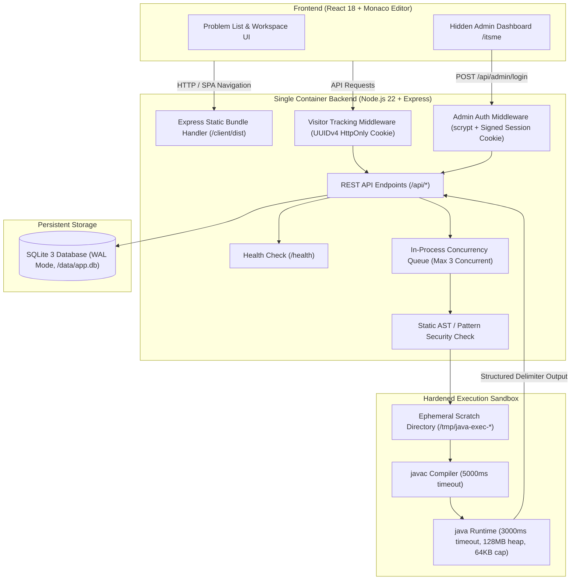

# DwM ☕⚡

> A production-grade, bare-minimum LeetCode-style coding drill platform built exclusively for Java. Features an isolated OpenJDK 21 sandboxed runner, silent anonymous visitor tracking, a split-pane Monaco code editor, and a hidden administrative observability dashboard.

---

## Table of Contents

1. [Overview](#overview)
2. [Architecture](#architecture)
3. [Key Features](#key-features)
4. [Sandbox & Security Engine](#sandbox--security-engine)
5. [Seed Problems](#seed-problems)
6. [Prerequisites](#prerequisites)
7. [Local Development Setup](#local-development-setup)
8. [Configuration & Environment](#configuration--environment)
9. [Running with Docker & Docker Compose](#running-with-docker--docker-compose)
10. [Google Cloud Serverless Deployment Guide](#google-cloud-serverless-deployment-guide)
11. [General Production Deployment](#general-production-deployment)
12. [API Reference](#api-reference)
13. [Hidden Admin Portal (`/itsme`)](#hidden-admin-portal-itsme)
14. [Testing & Quality Assurance](#testing--quality-assurance)

---

## Overview

**DrillWithMe** delivers an unopinionated, zero-friction coding drill experience for Java engineers. Users can immediately begin solving classic algorithmic problems without creating an account or authenticating. Meanwhile, every visitor is silently tracked with an anonymous cookie-backed session that correlates their visits, page views, and code submissions.

The platform is designed to deploy as a **single, self-contained multi-stage Docker container** packing both a modern **Node.js 22** runtime (serving React 18 and Express) and a hardened **OpenJDK 21 JDK** sandbox capable of compiling and executing untrusted user submissions under strict OS-level and JVM resource caps.

---

## Architecture

The application is structured as an npm workspaces monorepo with high cohesion and low coupling:

```
dwm/
├── client/                     # React 18 + Vite + Tailwind CSS + Monaco Editor
│   ├── src/
│   │   ├── api/                # Typed API client
│   │   ├── components/         # Monaco editor, Navbar, ConsoleOutput, Modal
│   │   ├── pages/              # ProblemList, Workspace, AdminLogin, AdminDashboard
│   │   └── App.tsx             # Client routing
│   └── vite.config.ts
├── server/                     # Node.js + Express + TypeScript + better-sqlite3
│   ├── src/
│   │   ├── config.ts           # Centralized environment configuration
│   │   ├── db/                 # SQLite schema, WAL pragmas, idempotent migrations, seed data
│   │   ├── middleware/         # Visitor tracking cookie & Admin auth middlewares
│   │   ├── routes/             # /health, /api/problems, /api/admin
│   │   ├── runner/             # Isolated OpenJDK compilation, execution, queue, security checks
│   │   └── index.ts            # Main HTTP server & static client bundle server
│   └── tests/                  # Vitest suite (runner, db, api integration)
├── scripts/
│   └── hash-password.mjs       # Scrypt password hashing utility for admin credentials
├── Dockerfile                  # Multi-stage build (Node 22 + OpenJDK 21)
├── docker-compose.yml          # Production-ready Compose with persistent volume
└── .github/workflows/ci.yml    # GitHub Actions workflow
```

### System Architecture Diagram



---

## Key Features

- **Instant Anonymous Practice:** No signup or login screens. Users are issued an `HttpOnly`, `SameSite=Lax` cookie (`visitor_id`) that automatically retains solved problems, code history, and submission verdicts.
- **Anonymous Custom Problem Mode (`/custom`):** Any visitor can write their own custom problem statement, write standalone Java code (`public class Main`), define custom test cases (stdin and expected outputs), and run them in real time with auto-save.
- **Admin Problem Management (`/itsme` -> "Problems"):** Complete CRUD interface for official Java problems: title, slug auto-generation, difficulty, Markdown preview, starter code, test harness code ("Load Example Harness" button), dynamic test cases builder, publish/draft toggle, and dry-run verification.
- **One-Click Promotion Workflow (`/itsme` -> "Anonymous Problems"):** Admins can inspect unique custom problems practiced anonymously, view run history and outputs, and promote any custom drill into an official published problem with pre-populated fields.
- **Production Monaco Editor:** Rich Java syntax highlighting, automatic indentation, bracket matching, and shortcut bindings (`Ctrl+Enter` / `Cmd+Enter` to run tests).
- **Hardened OpenJDK 21 Sandbox:** Runs real `javac` and `java` binaries directly with process group isolation, detached killing (`SIGKILL` to entire tree), JVM heap limits, strict CPU allocation, stdout/stderr truncation caps, and AST/regex escape prevention.
- **Concurrent Execution Throttling:** Bounded in-process FIFO execution queue preventing CPU exhaustion and OOM crashes from concurrent compiles.
- **Hidden Admin Observatory (`/itsme`):** A stealth administration portal with brute-force rate limiting, scrypt password authentication, global platform metrics, paginated visitor tables, and complete visitor drilldown (page visit audit log + exact Java code submissions).
- **WAL-Mode SQLite Persistence:** Zero-overhead relational database configured with `PRAGMA journal_mode = WAL;`, `foreign_keys = ON;`, and 5000ms busy timeout.
- **Single-Container Deployment:** The React single-page app is built and served directly by the Express backend, packaged with OpenJDK 21 into a single, minimal Docker container.

---

## Sandbox & Security Engine

Running untrusted user code requires multi-layered defense in depth. DrillWithMe implements five distinct isolation layers:

```
[ User Code Submission ]
         │
         ▼
Layer 1: Pre-Execution Static Analysis (Pattern Rejection)
         Reject: ProcessBuilder, Runtime, java.io.*, java.nio.*, java.net.*,
                 System.exit, reflection, javax.script, native bindings.
         │
         ▼
Layer 2: Concurrency Queue & Resource Throttling
         Max 3 parallel JVM executions. Excess requests wait up to 10s.
         │
         ▼
Layer 3: Ephemeral Filesystem Isolation
         Dedicated unique directory /tmp/java-exec-<uuid> created with 0700.
         Strictly removed in a finally block regardless of execution outcome.
         │
         ▼
Layer 4: Process-Group Spawning & Timed SIGKILL
         child_process.spawn with detached: true and shell: false.
         Compile Timeout: 5000ms. Execution Timeout: 3000ms.
         Timeouts execute process.kill(-pid, 'SIGKILL') terminating any spawned subprocesses.
         │
         ▼
Layer 5: JVM Flags & Memory Boundaries
         java -Xms32m -Xmx128m -XX:ActiveProcessorCount=1 -XX:+ExitOnOutOfMemoryError Main
         Output Cap: Output stream truncated at 64 KB to mitigate pipe flooding.
```

### Supported Verdicts

| Verdict | Meaning | Description |
| :--- | :--- | :--- |
| `ACCEPTED` | Passed | Solution produced correct answers for all test cases within time and memory bounds. |
| `WRONG_ANSWER` | Failed Tests | Code executed cleanly but output did not match expected test case output. |
| `COMPILE_ERROR` | Syntax Failure | `javac` compilation failed. Compiler diagnostics returned to editor console. |
| `RUNTIME_ERROR` | Exception Thrown | Uncaught Java exception (e.g. `NullPointerException`, `ArrayIndexOutOfBoundsException`). |
| `TIME_LIMIT_EXCEEDED` | Timeout | Execution exceeded `3000ms`. Process group forcibly terminated. |

---

## Seed Problems

DrillWithMe comes seeded out of the box with 5 classic Java interview problems. Each problem contains an idempotent schema definition, starter `Solution.java` template, custom test harness `Main.java`, 2+ visible sample test cases, and 3+ hidden edge-case tests:

| ID | Title | Slug | Difficulty | Key Concepts |
| :--- | :--- | :--- | :--- | :--- |
| **1** | Two Sum | `two-sum` | `Easy` | Hash Map, Array indexing, $O(n)$ time |
| **2** | Valid Palindrome | `valid-palindrome` | `Easy` | Two pointers, String sanitation, ASCII filtering |
| **3** | Valid Parentheses | `valid-parentheses` | `Easy` | Stack, Bracket balancing, Edge cases |
| **4** | Best Time to Buy and Sell Stock | `best-time-to-buy-and-sell-stock` | `Easy` | Single pass greedy, Min price tracking |
| **5** | Maximum Subarray | `maximum-subarray` | `Medium` | Kadane's algorithm, Dynamic programming |

---

## Prerequisites

Before running DrillWithMe locally, ensure you have:

- **Node.js**: `v22.0.0` or higher (verified with Node 22 LTS).
- **npm**: `v10.0.0` or higher.
- **Java Development Kit (JDK)**: **OpenJDK 21** (or OpenJDK 25) with both `javac` and `java` accessible in your system `PATH`.
- *(Optional)* **Docker & Docker Compose**: For containerized deployment.

Verify your local environment:
```bash
node -v      # Expected: v22.x.x
npm -v       # Expected: 10.x.x
javac -version # Expected: javac 21.x.x (or compatible)
java -version  # Expected: openjdk version "21.x.x"
```

---

## Local Development Setup

### 1. Clone & Install Dependencies

From the repository root, install workspace dependencies across both `server` and `client`:

```bash
git clone https://github.com/zeeroiq/drwil-with-me.git
cd drill-with-me

# Install dependencies for root, server, and client packages
npm install
```

### 2. Configure Environment Variables

Create your `.env` configuration from the provided `.env.example`:

```bash
cp .env.example .env
```

### 3. Generate Secure Admin Password Hash

Run the built-in scrypt hashing utility to generate a secure password hash for the `/itsme` admin dashboard:

```bash
node scripts/hash-password.mjs MySuperSecretPassword123!
```

Output:
```
--- Admin Password Hash Generated ---
Password: MySuperSecretPassword123!
Hash:     fa8b3f6ff378aae1ed2e27701bde4d39:89388d8d2031e09309faac992b93f72398ea5ac945c2e7eeb75cde4f285073ba609adeb23afc9b99877c4d805db54de46de1b0129a2f80403c536e02e8260cdd

Set this in your .env:
ADMIN_PASSWORD_HASH="fa8b3f6ff378aae1ed2e27701bde4d39:89388d8d2031e09309faac992b93f72398ea5ac945c2e7eeb75cde4f285073ba609adeb23afc9b99877c4d805db54de46de1b0129a2f80403c536e02e8260cdd"
```

Paste the resulting hash into `.env`:
```ini
ADMIN_USERNAME=admin
ADMIN_PASSWORD_HASH="fa8b3f6ff378aae1ed2e27701bde4d39:89388d8d2031e09309faac992b93f72398ea5ac945c2e7eeb75cde4f285073ba609adeb23afc9b99877c4d805db54de46de1b0129a2f80403c536e02e8260cdd"
```

### 4. Run Automated Test Suite

Run the Vitest test suites covering the database schema, OpenJDK execution runner, and API routes:

```bash
npm test
```

### 5. Start Development Servers

Run the backend and frontend in development mode with hot-reloading:

```bash
# Terminal 1: Backend Express Server (tsx watch)
npm run dev --workspace=server

# Terminal 2: Frontend Vite Dev Server (HMR on port 5173)
npm run dev --workspace=client
```

Open `http://localhost:5173` in your browser. Vite automatically proxies `/api` and `/health` requests to `http://localhost:3000`.

### 6. Production Build & Start Locally

To build and run the production bundle locally:

```bash
# Build React client and compile TypeScript backend
npm run build

# Start the production server
npm start
```

Access the application at `http://localhost:3000`.

---

## Configuration & Environment

All runtime configuration parameters are driven via environment variables with safe defaults:

| Variable | Type | Default | Description |
| :--- | :--- | :--- | :--- |
| `PORT` | Number | `3000` | Port on which the HTTP server listens. |
| `SQLITE_DB_PATH` | String | `./data/app.db` | Absolute or relative file path to the SQLite database. |
| `ADMIN_USERNAME` | String | `admin` | Username required for `/itsme` login. |
| `ADMIN_PASSWORD_HASH` | String | *(empty)* | Scrypt salt and hash string (`salt:hexKey`). |
| `SESSION_SECRET` | String | `drill-with-me-secret-key` | Secret key used to sign `admin_session` authentication cookies. |
| `EXECUTION_TIMEOUT_MS` | Number | `3000` | Execution timeout in milliseconds for user Java code. |
| `COMPILE_TIMEOUT_MS` | Number | `5000` | Compilation timeout in milliseconds for `javac`. |
| `MAX_CONCURRENT_RUNS` | Number | `3` | Maximum number of concurrent Java processes allowed in parallel. |

---

## Running with Docker & Docker Compose

The application includes an optimized multi-stage `Dockerfile` and a `docker-compose.yml` configured with persistent volume storage and health checks.

### Quick Start with Docker Compose

1. Ensure `.env` is configured in the root directory.
2. Build and start the container in detached mode:

```bash
docker compose up --build -d
```

3. View real-time logs:

```bash
docker compose logs -f dwm
```

4. Check container health status:

```bash
docker compose ps
```

The container starts as non-root user `appuser` (UID 10001) and mounts a named local volume `sqlite_data` to `/data`, persisting the database across container restarts.

### Manual Docker Build & Run

If running with raw Docker:

```bash
# 1. Build the production image
docker build -t dwm:latest .

# 2. Create a named volume for SQLite persistence
docker volume create dwm_data

# 3. Run the container
docker run -d \
  --name dwm \
  -p 3000:3000 \
  --env-file .env \
  -v dwm_data:/data \
  --restart unless-stopped \
  dwm:latest
```

---

## Google Cloud Serverless Deployment Guide

JavaDrill is designed to deploy automatically to **Google Cloud Run** using a fully automated, idempotent **GitHub Actions + Terraform** CI/CD pipeline. The architecture is engineered to run permanently within the **Google Cloud Always Free Tier** at **$0/month** while guaranteeing zero data loss for the SQLite database.

```mermaid
flowchart TD
    subgraph CI["GitHub Actions CI/CD Pipeline"]
        Test["Job 1: npm test & build (OpenJDK 21 + Node 22)"]
        WIF["Keyless OIDC Auth via GCP Workload Identity"]
        TFBootstrap["Bootstrap Remote State GCS Bucket"]
        TFPhase1["Phase 1: Targeted Apply (APIs & Artifact Registry)"]
        DockerBuild["Build & Push Slim Docker Image (GHA Cache)"]
        TFPhase2["Phase 2: Full Apply (Cloud Run, GCS, IAM, Secrets)"]
        SmokeTest["Smoke Test (/health 200, /api/admin/overview 401)"]
        Test --> WIF --> TFBootstrap --> TFPhase1 --> DockerBuild --> TFPhase2 --> SmokeTest
    end

    subgraph GCP["Google Cloud Platform (Always Free Architecture)"]
        CR["Cloud Run v2 (Serverless, min=0, max=1, 1Gi RAM, 1 CPU)"]
        GCS["GCS Bucket (Litestream SQLite WAL Backups)"]
        AR["Artifact Registry (Docker Images, keep_count=2)"]
        SM["Secret Manager (Admin Hash & Session Secret)"]

        CR -->|Continuous WAL Replicate| GCS
        GCS -->|Cold Start Restore| CR
        SM -->|Inject Env Secrets| CR
        AR -->|Pull Image| CR
    end
```



---

### 1. Overview of the Always Free Architecture

Google Cloud provides generous monthly allowances across core serverless resources that JavaDrill stays well within:

| Resource | GCP Always Free Allowance | JavaDrill Configuration & Guardrail | Steady-State Cost |
| :--- | :--- | :--- | :--- |
| **Cloud Run** | 2 Million requests/month<br>180,000 vCPU-seconds<br>360,000 GiB-seconds | `min_instances = 0` (scales to zero when idle)<br>`max_instances = 1` (prevents SQLite split-brain)<br>`cpu_idle = true` (request-based billing only)<br>`startup_cpu_boost = true` (fast cold start) | **$0.00** |
| **Cloud Storage (GCS)** | 5 GB-months Standard storage<br>5,000 Class A write operations<br>50,000 Class B read operations | 1 bucket for Litestream SQLite WAL replication<br>`sync-interval: 10s`, `snapshot-interval: 24h`<br>Lifecycle rule keeps 5 noncurrent versions / deletes archived >30d | **$0.00** |
| **Artifact Registry** | 0.5 GB/month storage | Terraform cleanup policy keeps **only the 2 most recent images** and automatically deletes untagged manifests | **$0.00** |
| **Secret Manager** | 6 active secret versions/month | Exactly **2 active secrets** (`ADMIN_PASSWORD_HASH` and `SESSION_SECRET`) | **$0.00** |
| **Networking & Add-ons** | Free HTTPS endpoint (`*.run.app`) | **Zero paid add-ons**: No VPC connectors, no Cloud SQL, no Redis, no Cloud NAT, no external Load Balancers | **$0.00** |

---

### 2. One-Time Setup: Workload Identity Federation (`scripts/bootstrap-gcp-wif.sh`)

Deployments authenticate via **Workload Identity Federation (WIF)** using GitHub's OIDC token exchange. This eliminates long-lived, high-risk JSON service account keys.

To set up WIF, run the idempotent bootstrap script from your local machine or Google Cloud Shell:

```bash
# Make script executable
chmod +x scripts/bootstrap-gcp-wif.sh

# Run with arguments:
# ./scripts/bootstrap-gcp-wif.sh <PROJECT_ID> <GITHUB_OWNER> [GITHUB_REPO] [REGION]
./scripts/bootstrap-gcp-wif.sh my-gcp-project-id my-github-username drill-with-me us-central1
```

#### What `bootstrap-gcp-wif.sh` Does:
1. **Enables Required APIs:** `iam.googleapis.com`, `cloudresourcemanager.googleapis.com`, `iamcredentials.googleapis.com`, `sts.googleapis.com`, `serviceusage.googleapis.com`.
2. **Creates Workload Identity Pool:** `github-actions-pool` (global).
3. **Creates OIDC Provider:** `github-actions-provider` mapped to `https://token.actions.githubusercontent.com` and restricted by attribute condition strictly to your GitHub repository (`${GITHUB_OWNER}/${GITHUB_REPO}`).
4. **Creates Deployer Service Account:** `github-actions-deployer@<PROJECT_ID>.iam.gserviceaccount.com`.
5. **Binds WIF Principal:** Grants `roles/iam.workloadIdentityUser` to tokens issued by your GitHub repository.
6. **Grants Minimal Required Project IAM Roles:**
   - `roles/run.admin`: Manage Cloud Run v2 services, revisions, and scaling settings.
   - `roles/artifactregistry.admin`: Create Docker repositories and push container images.
   - `roles/storage.admin`: Create and manage GCS buckets for Terraform state and Litestream SQLite replication.
   - `roles/iam.serviceAccountAdmin`: Create and manage the Cloud Run runtime service account.
   - `roles/iam.serviceAccountUser`: Attach the runtime service account to Cloud Run.
   - `roles/secretmanager.admin`: Provision and manage application secrets in Secret Manager.
   - `roles/serviceusage.serviceUsageAdmin`: Enable required runtime APIs declared in Terraform.
   - `roles/resourcemanager.projectIamAdmin`: Bind public invoker (`allUsers`) permissions to Cloud Run.

---

### 3. Configuring GitHub Repository Secrets

After running `bootstrap-gcp-wif.sh`, configure the following GitHub Repository Secrets in **Settings > Secrets and variables > Actions**:

| Secret Name | Required / Default | Description & Value |
| :--- | :--- | :--- |
| `GCP_PROJECT_ID` | **Required** | Your Google Cloud project ID (e.g. `my-gcp-project-123456`). |
| `GCP_REGION` | Optional (default: `us-central1`) | Free-tier US region: `us-central1`, `us-east1`, or `us-west1`. |
| `GCP_WIF_PROVIDER` | **Required** | Full provider path output by the bootstrap script: `projects/<PROJECT_NUM>/locations/global/workloadIdentityPools/github-actions-pool/providers/github-actions-provider` |
| `GCP_WIF_SERVICE_ACCOUNT` | **Required** | Deployer service account email: `github-actions-deployer@<PROJECT_ID>.iam.gserviceaccount.com` |
| `ADMIN_USERNAME` | Optional (default: `admin`) | Login username for the hidden admin dashboard (`/itsme`). |
| `ADMIN_PASSWORD_HASH` | **Required** | Scrypt hash generated with: `node scripts/hash-password.mjs <your-password>` |
| `SESSION_SECRET` | **Required** | Random 32-byte hex secret generated with: `openssl rand -hex 32` |

#### Quick Setup Using GitHub CLI (`gh`):

```bash
gh secret set GCP_PROJECT_ID --body "my-gcp-project-id"
gh secret set GCP_REGION --body "us-central1"
gh secret set GCP_WIF_PROVIDER --body "projects/1234567890/locations/global/workloadIdentityPools/github-actions-pool/providers/github-actions-provider"
gh secret set GCP_WIF_SERVICE_ACCOUNT --body "github-actions-deployer@my-gcp-project-id.iam.gserviceaccount.com"
gh secret set ADMIN_USERNAME --body "admin"
gh secret set ADMIN_PASSWORD_HASH --body "$(node scripts/hash-password.mjs 'YourStrongAdminPassword')"
gh secret set SESSION_SECRET --body "$(openssl rand -hex 32)"
```

---

### 4. How Litestream SQLite Replication Works with GCS

SQLite writes to a local file in WAL (Write-Ahead Logging) mode. In serverless environments like Cloud Run, container filesystems are ephemeral. **Litestream** solves this by continuously replicating SQLite WAL frames to Google Cloud Storage.

```
+-----------------------------------------------------------------------------------+
| Container Startup (docker-entrypoint.sh)                                         |
| 1. Run: litestream restore -if-db-not-exists -if-replica-exists                   |
|    -> If GCS has a backup, restore /data/app.db before Node boots                |
| 2. Exec: litestream replicate -exec "node server/dist/index.js"                  |
|    -> Litestream becomes PID 1, spawns Node.js as a child process                 |
+-----------------------------------------------------------------------------------+
                                         │
                                         ▼
+-----------------------------------------------------------------------------------+
| Running Container (Scale-to-Zero and Active Traffic)                              |
| - Express & SQLite process requests, visitors, and submissions                    |
| - Litestream monitors WAL changes and replicates frames to GCS every 10 seconds   |
+-----------------------------------------------------------------------------------+
                                         │
                                         ▼
+-----------------------------------------------------------------------------------+
| Container Teardown / Redeployment (SIGTERM Handling)                              |
| 1. Cloud Run sends SIGTERM                                                        |
| 2. Litestream forwards SIGTERM to Node.js                                         |
| 3. Node.js stops accepting new HTTP connections and calls db.close() cleanly      |
| 4. Node.js process exits 0                                                        |
| 5. Litestream flushes all remaining WAL frames to GCS and exits 0                 |
| Result: Zero Data Loss across cold starts, redeploys, or scale-to-zero events!    |
+-----------------------------------------------------------------------------------+
```

#### Free-Tier Tuning in `litestream.yml`:
- `sync-interval: 10s`: Limits GCS Class A write requests during heavy active traffic while ensuring low latency for WAL updates.
- `snapshot-interval: 24h`: Captures full snapshots once per day to prune transaction logs.
- `retention: 72h`: Keeps only 3 days of point-in-time recovery data, ensuring total storage is mere megabytes (well below the 5 GB free tier limit).

---

### 5. Manual Disaster Recovery & Point-in-Time Restore

If you ever need to inspect backups, recover corrupted data, or perform a point-in-time restore, you can do so directly from your workstation:

#### 1. Inspect Backup Bucket in GCS
```bash
# List backups in the replication bucket
gcloud storage ls gs://<PROJECT_ID>-drill-with-me-sqlite-data/app.db/
```

#### 2. Install Litestream Locally
```bash
# macOS
brew install litestream

# Linux
curl -L -o /tmp/litestream.tar.gz https://github.com/benbjohnson/litestream/releases/download/v0.3.13/litestream-v0.3.13-linux-amd64.tar.gz
sudo tar -C /usr/local/bin -xzf /tmp/litestream.tar.gz litestream
```

#### 3. List Backup Generations and Snapshots
```bash
litestream generations gs://<PROJECT_ID>-drill-with-me-sqlite-data/app.db
litestream snapshots gs://<PROJECT_ID>-drill-with-me-sqlite-data/app.db
```

#### 4. Restore the Database to a Local File
```bash
# Restore latest state:
litestream restore -o ./recovered-app.db gs://<PROJECT_ID>-drill-with-me-sqlite-data/app.db

# Or restore to a specific point in time:
litestream restore -timestamp "2026-11-19T10:00:00Z" -o ./recovered-app.db gs://<PROJECT_ID>-drill-with-me-sqlite-data/app.db
```

#### 5. Verify Database Integrity
```bash
sqlite3 ./recovered-app.db "PRAGMA integrity_check;"
sqlite3 ./recovered-app.db "SELECT count(*) FROM visitors; SELECT count(*) FROM submissions;"
```

---

### 6. Zero-Cost Guardrails & Setting a $1 GCP Billing Budget Alert

To guarantee you never exceed free-tier limits, JavaDrill implements the following structural guardrails:

1. **Cloud Run Concurrency & Instance Capping:**
   - `max_instances = 1`: Eliminates concurrent database lock contention and limits compute consumption.
   - `min_instances = 0`: Cloud Run scales to zero when no traffic arrives.
   - `cpu_idle = true`: You are only billed while an active request is being processed.
2. **Artifact Registry Automatic Pruning:**
   - Terraform configures `cleanup_policies` on the Docker repository to retain **only the last 2 image versions** and delete all untagged images. This maintains storage under the 0.5 GB free limit.
3. **GCS Lifecycle Policies:**
   - Automatic deletion of noncurrent objects older than 30 days keeps GCS storage well within the 5 GB free tier.
4. **Secret Manager Active Version Limit:**
   - Secrets are managed with exactly 2 active versions total (free tier includes 6 active versions).

#### Setting a $1 GCP Billing Budget Alert

To protect against unexpected billing spikes, configure a budget alert in Google Cloud:

##### Via Google Cloud Console:
1. Open the [GCP Billing Budgets & Alerts Console](https://console.cloud.google.com/billing/budgets).
2. Click **Create Budget**.
3. **Name:** `drill-with-me-zero-cost-alert`.
4. **Projects:** Select your DrillWithMe project.
5. **Amount Type:** Specified amount -> **$1.00 USD**.
6. **Actions:**
   - Check **Trigger on 50% ($0.50), 90% ($0.90), and 100% ($1.00) of budget**.
   - Check **Send email alerts to billing account administrators**.
7. Click **Finish**.

##### Via gcloud CLI:
```bash
# Get your billing account ID
BILLING_ACCOUNT=$(gcloud billing accounts list --format="value(name)" | head -n1)

# Create the $1 threshold budget
gcloud billing budgets create \
  --billing-account="${BILLING_ACCOUNT}" \
  --display-name="drill-with-me-zero-cost-guardrail" \
  --budget-amount=1.00USD \
  --threshold-rules=percent=0.5,basis=CURRENT_SPEND \
  --threshold-rules=percent=0.9,basis=CURRENT_SPEND \
  --threshold-rules=percent=1.0,basis=CURRENT_SPEND \
  --filter-projects="projects/${PROJECT_ID}"
```

---

### 7. Triggering Deployment

Once GitHub Secrets are saved, deployment triggers automatically:
1. **Automated Continuous Deployment:** Push any commit to the `main` branch.
2. **Manual Dispatch / Dry Run:** Go to **Actions > Production Deployment > Run workflow**.
   - Toggle `dry_run: true` to execute a `terraform plan` without applying changes.
   - Toggle `dry_run: false` to execute a full deployment.

---

## General Production Deployment

### SQLite Persistence Strategy

SQLite operates in **WAL (Write-Ahead Logging)** mode for high-concurrency read performance. When deploying to containerized or cloud environments, keep the following persistence principles in mind:

1. **Persistent Volume Mounts:**
   - Mount a persistent block volume (AWS EBS, GCP Persistent Disk, DigitalOcean Block Storage, or Kubernetes PersistentVolumeClaim) to `/data`.
   - Never place the database on network filesystems with incomplete lock semantics (e.g. basic NFS) to avoid database corruption under concurrent WAL writes.
2. **Stateless / Cloud Run Deployments (Litestream):**
   - For serverless containers like Google Cloud Run or AWS Fargate, attach a Cloud Storage volume mount, or integrate [Litestream](https://litestream.io/) to continuously stream SQLite WAL changes to an S3 or Google Cloud Storage bucket.
3. **Directory Ownership:**
   - Ensure the `/data` directory is owned by UID `10001` (`appuser`) with permissions `chmod 700 /data`. The Dockerfile sets this up automatically.

### Container Security Baseline

- **Non-Root Execution:** The application executes under user `appuser` (UID 10001, GID 10001). It has no sudo/root privileges.
- **Read-Only Code Directory:** The application root (`/app`) does not permit write access to the runtime user. Only `/data` (SQLite) and `/tmp` (ephemeral runner execution) are writable.
- **Strict Scratch Cleanup:** Temp directories `/tmp/java-exec-<uuid>` are guaranteed to be unlinked in `finally` blocks, preventing inode leakage.

---

## API Reference

### Public Endpoints

#### `GET /health`
Verifies backend connectivity, database integrity, and `javac`/`java` availability.
- **Auth:** None
- **Response `200 OK`:**
  ```json
  {
    "status": "ok",
    "timestamp": "2026-11-19T03:00:00.000Z",
    "database": {
      "connected": true,
      "walMode": true
    },
    "java": {
      "compilerAvailable": true,
      "runtimeAvailable": true
    }
  }
  ```


#### `GET /api/problems`
Fetches all coding problems with solve/attempt badges for the current visitor.
- **Auth:** Anonymous (reads `visitor_id` cookie)
- **Response `200 OK`:**
  ```json
  [
    {
      "id": 1,
      "slug": "two-sum",
      "title": "Two Sum",
      "difficulty": "Easy",
      "solved": true,
      "attempted": true
    }
  ]
  ```

#### `GET /api/problems/:slug`
Fetches a single problem description, starter code, and visible sample test cases.
- **Auth:** Anonymous
- **Response `200 OK`:**
  ```json
  {
    "id": 1,
    "slug": "two-sum",
    "title": "Two Sum",
    "difficulty": "Easy",
    "descriptionMd": "Given an array of integers `nums`...",
    "starterCode": "class Solution {\n    public int[] twoSum(int[] nums, int target) {\n        \n    }\n}",
    "visibleTestCases": [
      {
        "id": 1,
        "inputDisplay": "nums = [2,7,11,15], target = 9",
        "expectedOutput": "[0,1]"
      }
    ],
    "userStatus": {
      "solved": false,
      "attempted": true,
      "lastSubmittedCode": "class Solution { ... }"
    }
  }
  ```


#### `POST /api/problems/:slug/run`
Executes user solution against **visible sample test cases only**. Does not record a permanent submission.
- **Auth:** Anonymous
- **Request Body:**
  ```json
  {
    "code": "class Solution {\n    public int[] twoSum(int[] nums, int target) {\n        // ...\n    }\n}"
  }
  ```

- **Response `200 OK`:**
  ```json
  {
    "verdict": "ACCEPTED",
    "passedCount": 2,
    "totalCount": 2,
    "runtimeMs": 142,
    "testResults": [
      {
        "testCaseId": 1,
        "passed": true,
        "inputDisplay": "nums = [2,7,11,15], target = 9",
        "expectedOutput": "[0,1]",
        "actualOutput": "[0,1]",
        "stdout": "",
        "stderr": ""
      }
    ]
  }
  ```


#### `POST /api/problems/:slug/submit`
Executes user solution against **both visible and hidden test cases**, records the submission in SQLite, and updates solved status.
- **Auth:** Anonymous
- **Request Body:** Same as `/run`.
- **Response `200 OK`:**
  ```json
  {
    "submissionId": 42,
    "verdict": "ACCEPTED",
    "passedCount": 5,
    "totalCount": 5,
    "runtimeMs": 188,
    "errorOutput": null
  }
  ```


---

### Protected Admin Endpoints

All admin endpoints require an authenticated `admin_session` signed HTTP cookie. Unauthenticated requests return `401 Unauthorized`.

#### `POST /api/admin/login`
Authenticates the administrator using timing-safe scrypt comparison. Protected by IP rate limiting.
- **Request Body:**
  ```json
  {
    "username": "admin",
    "password": "MySuperSecretPassword123!"
  }
  ```

- **Response `200 OK`:**
  Sets `admin_session` cookie (`HttpOnly`, `SameSite=Strict`).
  ```json
  {
    "success": true,
    "message": "Authenticated successfully"
  }
  ```


#### `POST /api/admin/logout`
Clears the `admin_session` cookie.

#### `GET /api/admin/overview`
Returns high-level platform analytics:
- **Response `200 OK`:**
  ```json
  {
    "totalUniqueVisitors": 142,
    "totalPageVisits": 890,
    "totalSubmissions": 312,
    "acceptedSubmissions": 184,
    "overallAcceptanceRate": 0.5897,
    "problems": [
      {
        "id": 1,
        "title": "Two Sum",
        "slug": "two-sum",
        "difficulty": "Easy",
        "totalAttempts": 120,
        "totalSolves": 85
      }
    ]
  }
  ```


#### `GET /api/admin/visitors`
Returns a paginated list of tracked anonymous visitors sorted by recent activity.
- **Query Params:** `?page=1&limit=25&search=192.168`
- **Response `200 OK`:**
  ```json
  {
    "visitors": [
      {
        "id": "a5e9f801-b648-4cb9-b88a-2e4b31a590b1",
        "ipAddress": "192.168.1.100",
        "userAgent": "Mozilla/5.0 ...",
        "firstSeenAt": "2026-11-19T01:15:00.000Z",
        "lastSeenAt": "2026-11-19T03:02:11.000Z",
        "visitCount": 14,
        "problemsAttempted": 3,
        "problemsSolved": 2
      }
    ],
    "pagination": {
      "page": 1,
      "limit": 25,
      "total": 142,
      "totalPages": 6
    }
  }
  ```


#### `GET /api/admin/visitors/:id`
Returns complete behavioral and submission drilldown for a single visitor:
- **Response `200 OK`:**
  ```json
  {
    "visitor": { ... },
    "pageVisits": [
      { "path": "/", "visitedAt": "2026-11-19T01:15:00.000Z" },
      { "path": "/problems/two-sum", "visitedAt": "2026-11-19T01:16:30.000Z" }
    ],
    "submissions": [
      {
        "id": 42,
        "problemTitle": "Two Sum",
        "problemSlug": "two-sum",
        "verdict": "ACCEPTED",
        "passedCount": 5,
        "totalCount": 5,
        "runtimeMs": 188,
        "code": "class Solution { ... }",
        "errorOutput": null,
        "createdAt": "2026-11-19T01:22:15.000Z"
      }
    ]
  }
  ```

#### Anonymous Custom Problem Endpoints
- `POST /api/custom-problems`: Create a new custom problem session. Returns `{ id }`.
- `GET /api/custom-problems`: List all custom problems created by the current visitor.
- `GET /api/custom-problems/:id`: Retrieve details and test cases (ownership-protected).
- `PUT /api/custom-problems/:id`: Auto-save updates to title, statement, code, custom test cases.
- `POST /api/custom-problems/:id/run`: Run standalone Java code (`public class Main`) against custom test cases (stdin/expected output).

#### Admin Problem Management & Promotion Endpoints (`/api/admin/**`)
- `GET /api/admin/problems`: List all official problems (including drafts) with stats.
- `GET /api/admin/problems/:id`: Full problem details with all test cases (visible & hidden).
- `POST /api/admin/problems`: Create a new problem + test cases in a single transaction (supports `source_custom_problem_id` to link promoted drills).
- `PUT /api/admin/problems/:id`: Update problem fields and test cases, toggle `is_published`.
- `DELETE /api/admin/problems/:id`: Safely delete problem with cascade.
- `POST /api/admin/problems/dry-run`: Dry-run sample solution against harness and test cases in sandbox without saving.
- `GET /api/admin/custom-problems`: List unique anonymous custom problems with filters (`all`, `unpromoted`, `promoted`).
- `GET /api/admin/custom-problems/:id`: Detailed view of anonymous problem, code, and execution run history.

---

## Hidden Admin Portal (`/itsme`)

The `/itsme` portal provides administrative observability over visitor activity and platform health:

1. **Hidden Navigation:** No navbar links, footer items, or sitemaps reference `/itsme`.
2. **Accessing the Portal:**
   Navigate directly to `http://localhost:3000/itsme` in your browser.
3. **Authentication:**
   Login with the username and password configured in `.env` (`ADMIN_USERNAME` and `ADMIN_PASSWORD_HASH`).
4. **Features Available:**
   - **Global Statistics Cards:** Real-time visitor counts, submissions, and acceptance rates.
   - **Interactive Visitor Table:** Filter by IP or search visitor ID, with instant metrics on attempts vs solves.
   - **Deep Visitor Inspection Modal:** Click any visitor row to open the inspection drawer. Review their exact path trajectory through the site and inspect their submitted Java source code directly in an embedded read-only Monaco code viewer.

---

## Testing & Quality Assurance

DrillWithMe maintains a comprehensive test suite using **Vitest**:

```bash
# Run all unit and integration tests
npm test

# Run tests in watch mode
npx vitest --watch

# Run only the OpenJDK execution sandbox tests
npx vitest run server/tests/runner.test.ts

# Run database schema and idempotency tests
npx vitest run server/tests/db.test.ts

# Run API endpoint integration tests
npx vitest run server/tests/api.test.ts
```

### CI/CD Workflow (`.github/workflows/ci.yml`)

Every push and pull request to `main` executes the automated CI pipeline:
1. Matrix checkout and dependency cache resolution.
2. Setup of **Temurin OpenJDK 21** and **Node.js 22**.
3. Verification of `javac`, `java`, `node`, and `npm` availability.
4. Execution of the full Vitest suite.
5. Production bundle compilation (`npm run build`).
6. Clean Docker container build verification (`docker build -t dwm:ci .`).

---

## License

MIT © [ZeeroIQ Team](https://github.com/zeeroiq/drill-with-me)
